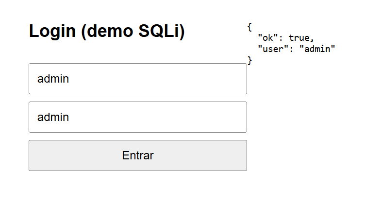
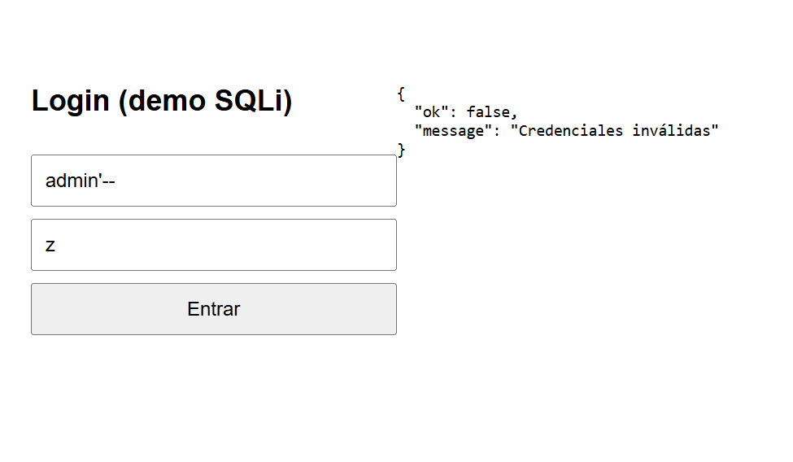
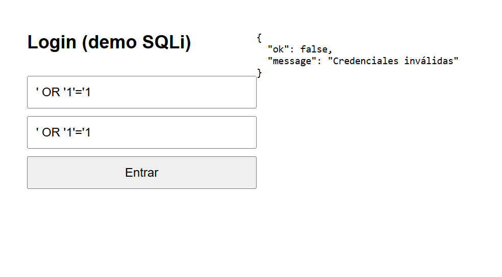

# Login vulnerable a SQL Injection

**Materia:** Seguridad Informática — UACAM
**Alumno:** Angel Antonio Pérez Reyes
**Rama:** 66823_PEREZ

## 1. De qué se trata

Es una página de login de práctica (`index.html`) con un servidor hecho en Node.js (`server-vulnerable.js`). El servidor usa una base de datos SQLite en memoria con dos usuarios: `admin / admin` y `juan / 1234`.

La versión original del profe tenía una falla de **SQL Injection**: armaba la consulta pegando (concatenando) el texto que escribe el usuario. Con eso, una persona podía entrar sin saber la contraseña. En esta práctica se corrige esa falla usando una **consulta parametrizada**.

## 2. Cómo correrlo

Se necesita tener Node.js instalado.

```bash
cd login
npm install
node server-vulnerable.js
```

Después se abre `http://localhost:3000` en el navegador. Escribes usuario y contraseña, das clic en **Entrar** y la respuesta del servidor aparece a la derecha en formato JSON.

## 3. Cuál era el error

El código original armaba el SQL así:

```js
const query = `SELECT * FROM users WHERE username = '${username}' AND password = '${password}'`;
db.get(query, (err, row) => { ... });
```

El problema es que lo que escribe el usuario se mezcla con el SQL. Si el usuario escribe comillas y palabras de SQL, deja de ser un dato y se convierte en parte de la consulta. Así quedaba la consulta con cada caso:

| Lo que se escribe (usuario / contraseña) | Consulta que se ejecutaba | Resultado en la versión vulnerable |
|---|---|---|
| `admin` / `admin` | `SELECT * FROM users WHERE username = 'admin' AND password = 'admin'` | Entra (es normal) |
| `admin'--` / `z` | `SELECT * FROM users WHERE username = 'admin'--' AND password = 'z'` | **Entra como admin** sin saber la contraseña |
| `' OR '1'='1` / `' OR '1'='1` | `SELECT * FROM users WHERE username = '' OR '1'='1' AND password = '' OR '1'='1'` | **Entra como admin** |

Cómo funciona cada ataque:

- **`admin'--`**: la comilla cierra el texto del usuario y `--` es un comentario en SQL. Todo lo que sigue, incluida la comprobación de la contraseña, se ignora.
- **`' OR '1'='1`**: agrega una condición que siempre es verdadera (`'1'='1'`). Como se une con `OR`, la consulta devuelve usuarios sin importar lo que se escribió.

Probé estas dos entradas contra la consulta original y las dos devolvieron al usuario `admin`.

## 4. La corrección

La consulta ahora lleva signos `?` en lugar de los valores, y los valores se mandan aparte en un arreglo:

```js
const query = "SELECT * FROM users WHERE username = ? AND password = ?";

console.log("Query ejecutada:", query, [username, password]);

db.get(query, [username, password], (err, row) => {
  if (err) return res.status(500).json({ error: err.message });
  if (row) return res.json({ ok: true, user: row.username });
  res.status(401).json({ ok: false, message: "Credenciales inválidas" });
});
```

Así SQLite recibe la consulta y los datos **por separado**. Lo que escriba el usuario siempre se trata como un valor de texto, nunca como código SQL. Por eso `admin'--` se busca como un nombre de usuario literal (que no existe) y no como un comentario.

El único cambio extra fue el `console.log`, que ahora también muestra los valores recibidos. El resto del funcionamiento es igual.

## 5. Pruebas

Se probó en el navegador con la versión corregida.

| # | Usuario | Contraseña | Resultado esperado | Resultado obtenido |
|---|---|---|---|---|
| 1 | `admin` | `admin` | Debe entrar | `{"ok": true, "user": "admin"}` ✅ |
| 2 | `admin'--` | `z` | Credenciales inválidas | `{"ok": false, "message": "Credenciales inválidas"}` ✅ |
| 3 | `' OR '1'='1` | `' OR '1'='1` | Credenciales inválidas | `{"ok": false, "message": "Credenciales inválidas"}` ✅ |

**Prueba 1: login normal (`admin` / `admin`)**



**Prueba 2: ataque con comentario (`admin'--` / `z`)**



**Prueba 3: ataque con condición siempre verdadera (`' OR '1'='1`)**



La corrección funciona: el usuario válido sigue entrando y los dos ataques ya no.

## 6. Qué más se podría mejorar

La consulta parametrizada resuelve la inyección SQL, pero el login todavía tiene otros puntos débiles:

- **Contraseñas en texto plano.** Se guardan tal cual (`admin`, `1234`). Deberían guardarse como un hash con sal, por ejemplo con bcrypt o argon2.
- **Sin límite de intentos.** Alguien puede probar contraseñas sin parar (fuerza bruta). Convendría limitar intentos o bloquear temporalmente.
- **Contraseñas débiles.** `admin / admin` es de las primeras que se prueban. Debería exigirse una política de contraseñas.
- **Sin validación de entrada.** Se podría revisar el tipo y la longitud de los datos antes de consultar la base.
- **Sin HTTPS.** Las credenciales viajan sin cifrar. En un sitio real debe usarse HTTPS.
- **Sin sesiones.** Al entrar solo se responde un JSON; no hay una sesión o token seguro.
- **Mensajes de error.** El error de base de datos se devuelve completo (`err.message`); en producción conviene mostrar un mensaje genérico y guardar el detalle en un registro interno.
- **Usuario con permisos mínimos.** La aplicación debería conectarse a la base con una cuenta que tenga solo los permisos necesarios.

## 7. Conclusión

La SQL Injection ocurre cuando se mezclan datos del usuario con el código SQL. En esta práctica se vio cómo `admin'--` y `' OR '1'='1` permitían entrar como `admin` sin conocer la contraseña. Con una consulta parametrizada (`?` y un arreglo de valores) el problema se elimina con un cambio muy pequeño en el código, y las pruebas lo confirman: el login normal funciona y los ataques fallan. Aun así, la seguridad de un login no termina ahí; faltan prácticas como guardar contraseñas con hash y limitar los intentos.
