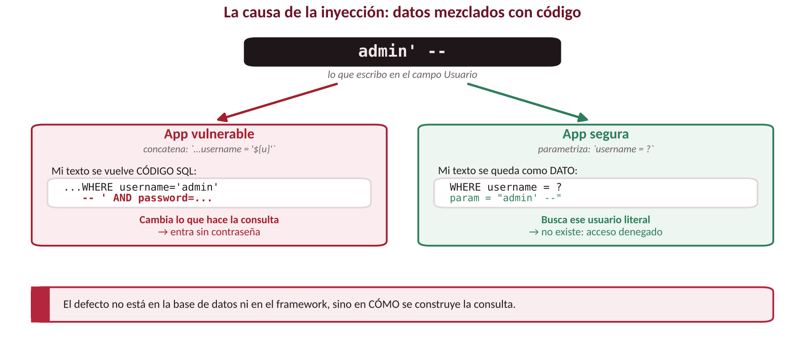
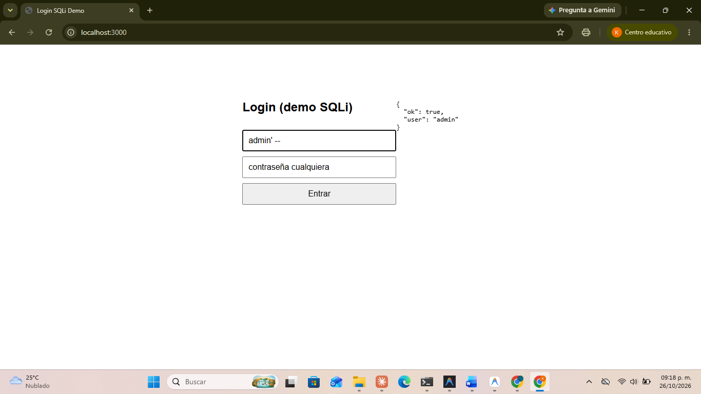
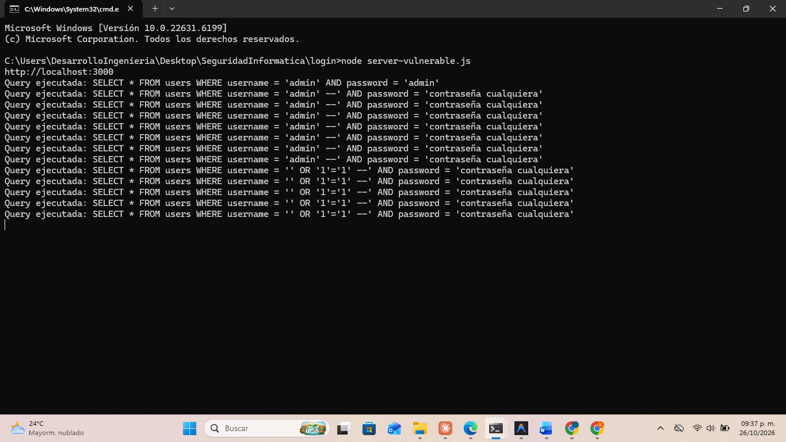
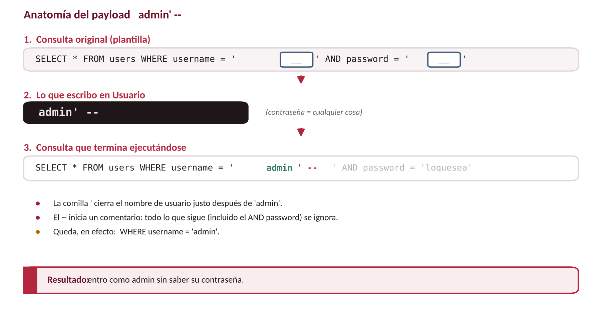
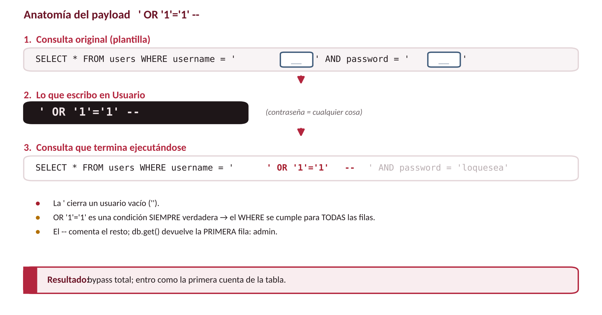
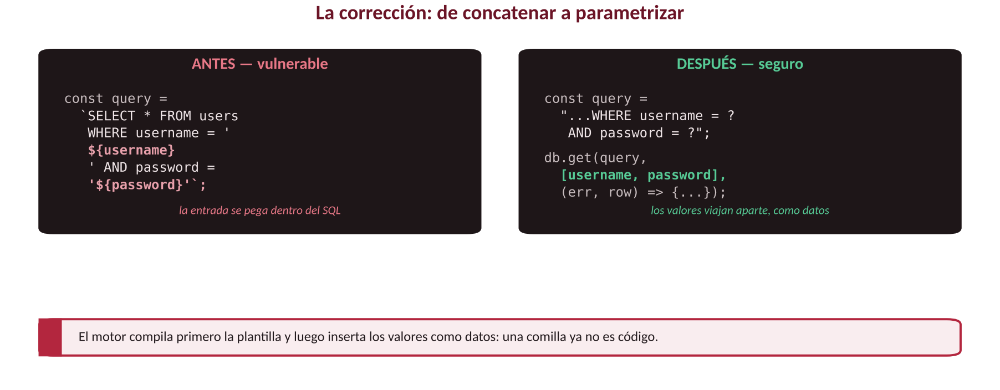
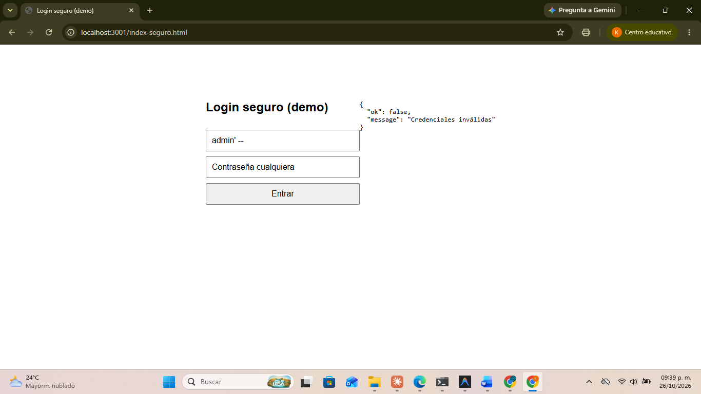
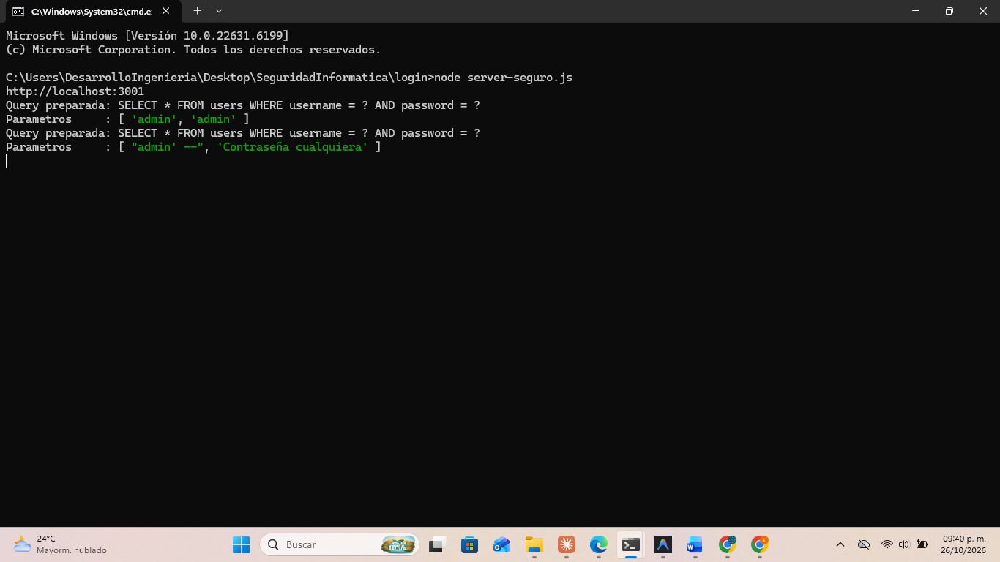
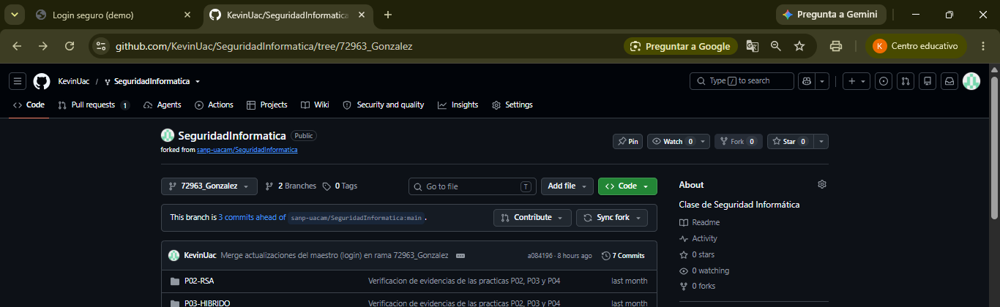

<h1 align="center">🛡️ Login SQL Injection — Explotación y corrección</h1>

<p align="center">
  <strong>2do Parcial · Login SQL injection</strong><br>
  Seguridad Informática · Facultad de Ingeniería · Universidad Autónoma de Campeche (UACAM)
</p>

<p align="center">
  
  
  
  
  
  
</p>

---

## 📌 De qué trata la práctica

Analizo una app de **login** en **Node.js + Express** (con **SQLite en memoria**) que el profesor nos
pasó. El endpoint `/login-vulnerable` arma su consulta **concatenando** directamente lo que escribe el
usuario, lo que abre la puerta a **inyección SQL**. En esta práctica:

1. **Demuestro cinco payloads que funcionan**, cubriendo distintas técnicas: comentario, tautología OR,
   inyección en el campo contraseña, `UNION SELECT` y fuga de información por mensaje de error.
2. **Explico por qué funcionan**, a nivel de la consulta SQL.
3. **Corrijo la vulnerabilidad** con **consultas parametrizadas** + validación de entrada (`server-seguro.js`).
4. **Verifico** que el login legítimo sigue vivo y que los cinco ataques quedan bloqueados.
5. Dejo preparado el **Pull Request** de la versión segura.

> ⚠️ **Entorno autorizado de laboratorio.** Todo corre en mi propia máquina (`localhost`), contra una app
> hecha a propósito para la práctica. No se atacó ningún sistema real.

---

## 📂 Contenido de la carpeta

```
login/
├── server-vulnerable.js     # App original (vulnerable a SQLi) — puerto 3000
├── server-seguro.js         # App corregida (parametrización + validación) — puerto 3001
├── index.html               # Formulario de login contra el endpoint vulnerable (:3000)
├── index-seguro.html        # Formulario de login contra el endpoint seguro (:3001)
├── package.json             # Dependencias: express, sqlite3
├── probar-login.ps1         # Script para reproducir las pruebas (normal + payloads)
├── figuras/                 # Diagramas (anatomía de la inyección, concepto, corrección)
└── evidencias/              # Capturas reales del proceso (navegador + terminal)
```

---

## ▶️ Cómo ejecutarlo

```bash
# 1) Instalar dependencias (una sola vez)
npm install

# 2a) Versión VULNERABLE  ->  abre http://localhost:3000
node server-vulnerable.js

# 2b) Versión SEGURA      ->  abre http://localhost:3001/index-seguro.html
node server-seguro.js
```

Cuentas de prueba cargadas en la base: **`admin` / `admin`** y **`juan` / `1234`**.

---

## 🔎 La vulnerabilidad

El endpoint vulnerable construye el `SELECT` pegando la entrada del usuario dentro del texto SQL:

```js
const query =
  `SELECT * FROM users WHERE username = '${username}' AND password = '${password}'`;
```

La base de datos **no distingue** entre el código que escribió el programador y lo que escribo yo en el
formulario. Si mi entrada trae símbolos de SQL (una comilla `'`, un guion doble `--` o la palabra
`UNION`), dejo de ser *un dato* y me convierto en *parte del código* de la consulta. Además, el endpoint
regresa el **mensaje de error crudo** del motor SQL (`err.message`) si la consulta queda mal formada —
eso también es explotable, como muestro en el payload 5.

<p align="center">
  
</p>

---

## 💥 Payloads que funcionan

| # | Payload | Campo | Efecto | SQL que se ejecuta (resumido) |
|---|---|---|---|---|
| 1 | `admin' --` | Usuario | Entra como **admin** sin su contraseña | `...username = 'admin' --' AND password = ...` |
| 2 | `' OR '1'='1' --` | Usuario | **Bypass total** (primera fila: admin) | `...username = '' OR '1'='1' --' AND ...` |
| 3 | `x' OR '1'='1' --` | **Contraseña** (con usuario `juan`) | Bypass también inyectando por la contraseña | `...username='juan' AND password='x' OR '1'='1' --'` |
| 4 | `' UNION SELECT 1,'hacker','x' --` | Usuario | **Fabrica** una sesión para un usuario que no existe en la BD | `...username='' UNION SELECT 1,'hacker','x' --'...` |
| 5 | `admin'` (comilla suelta) | Usuario | La consulta queda mal formada y el servidor **expone el error SQL crudo** al cliente | `...username='admin''...` → `SQLITE_ERROR: unrecognized token` |

Los dos primeros los probé en el campo **Usuario** con cualquier contraseña; el payload 3 muestra que el
campo **Contraseña** es igual de vulnerable; el 4 demuestra que no hace falta una cuenta real para entrar
(se puede *fabricar* una fila completa); el 5 no entra al sistema, pero filtra información interna que un
atacante usaría para afinar el resto de los ataques.

<p align="center">
  
</p>

La prueba más clara está en la **consola del servidor** (gracias al `console.log` del query): se ve el SQL
real con mi entrada ya incrustada.

<p align="center">
  
</p>

---

## 🧠 Por qué funcionan

<table>
<tr><td width="50%" valign="top">

**`admin' --`**
- La comilla `'` **cierra** el nombre de usuario antes de tiempo.
- El `--` inicia un **comentario** de SQL: anula todo lo que sigue, incluido el `AND password`.
- Queda `WHERE username = 'admin'` → entra como admin.

</td><td width="50%" valign="top">

**`' OR '1'='1' --`**
- La `'` cierra un usuario **vacío**.
- `OR '1'='1'` es una condición **siempre verdadera** → el `WHERE` se vuelve verdadero para todas las filas.
- `--` comenta el resto; `db.get()` devuelve la **primera** fila (admin).

</td></tr>
</table>

<p align="center">
  
  
</p>

**Los otros tres, mismo origen, distinta forma:**

- **Contraseña (`x' OR '1'='1' --`):** la concatenación ocurre en los *dos* huecos de la consulta, no solo
  en el usuario. Si el campo contraseña también se pega sin filtrar, la misma tautología funciona ahí.
- **`UNION SELECT 1,'hacker','x' --`:** `UNION` pega el resultado de una segunda consulta a la primera.
  Como la tabla `users` tiene tres columnas (`id, username, password`), armo un `SELECT` con tres valores
  inventados; la app recibe una fila que **nunca existió** en la base y responde como si fuera real.
- **Comilla suelta (`admin'`):** deja la consulta con comillas desbalanceadas → error de sintaxis en
  SQLite. El endpoint hace `res.status(500).json({ error: err.message })`, así que ese error —que
  revela el motor de base de datos y parte de la consulta— llega directo al navegador del atacante.

> 📎 En SQLite (y en SQL estándar) el `--` marca un comentario de línea, por eso basta para anular el resto
> de la consulta. El defecto está en la **concatenación**, no en la base de datos.

---

## ✅ La corrección: parametrización + validación

En `server-seguro.js` el endpoint `/login-seguro` usa **consultas preparadas** con marcadores `?`, más una
validación de entrada y un manejo de errores que no expone detalles internos:

```js
// Validación: tipo y longitud antes de tocar la base de datos
if (typeof username !== "string" || typeof password !== "string") { ... }
const u = username.trim();
const p = password.trim();
if (u.length === 0 || u.length > 64 || p.length === 0 || p.length > 64) { ... }

// CORRECCIÓN: la plantilla SQL es FIJA y usa marcadores (?)
const query = "SELECT * FROM users WHERE username = ? AND password = ?";
db.get(query, [u, p], (err, row) => {
  if (err) {
    console.error("Error interno:", err.message); // solo se loguea, NO se expone al cliente
    return res.status(500).json({ ok: false, message: "Error interno del servidor" });
  }
  /* ... */
});
```

El driver envía la **plantilla SQL** y los **valores** por canales separados: el motor compila primero la
consulta y luego mete los valores como **datos**, nunca como código. Así, una comilla, un `--` o la
palabra `UNION` en mi entrada se guardan como texto literal y ya no rompen nada — y de paso, como la
consulta ya no puede fallar por un payload malformado, **tampoco hay mensaje de error que filtrar**: el
payload 5 también queda neutralizado, no por la validación, sino por la misma parametrización.

<p align="center">
  
</p>

### Verificación

| Prueba | Vulnerable (`:3000`) | Seguro (`:3001`) |
|---|---|---|
| `admin` / `admin` | ✅ entra | ✅ entra |
| `juan` / `1234` | ✅ entra | ✅ entra |
| `admin' --` (usuario) | 🔴 **entra (vulnerable)** | 🟢 **bloqueado** |
| `' OR '1'='1' --` (usuario) | 🔴 **entra (vulnerable)** | 🟢 **bloqueado** |
| `x' OR '1'='1' --` (contraseña) | 🔴 **entra (vulnerable)** | 🟢 **bloqueado** |
| `' UNION SELECT 1,'hacker','x' --` | 🔴 **entra como "hacker" (vulnerable)** | 🟢 **bloqueado** |
| `admin'` (comilla suelta) | 🔴 **filtra el error SQL** | 🟢 **sin fuga — responde "Credenciales inválidas"** |

<p align="center">
  
</p>

El log del servidor seguro confirma el porqué: la plantilla `username = ? AND password = ?` **nunca
cambia**, y cada payload viaja como **parámetro** (dato), sin importar si trae comillas, `--` o `UNION`:

<p align="center">
  
</p>

---

## 🔀 Pull Request de la versión segura

Mi trabajo de la materia vive en mi fork `KevinUac/SeguridadInformatica`, en la rama **`72963_Gonzalez`**
— ahí está `server-seguro.js` junto con el resto de mis prácticas. El Pull Request se abre desde esa rama
hacia `sanp-uacam/SeguridadInformatica:main`, con el mismo formato que usan mis compañeros de grupo
(`72963_Gonzalez Login SQL injection`).

<p align="center">
  
</p>

---

## 🖼️ Evidencias

Las capturas reales del proceso están en [`evidencias/`](evidencias):

| Archivo | Qué muestra |
|---|---|
| `01_login_normal.png` | Login legítimo `admin/admin` en el navegador (línea base) |
| `02_payload_admin.png` | Payload `admin' --` entrando como admin sin contraseña |
| `03_payload_or.png` | Payload `' OR '1'='1' --` (bypass total) |
| `04_log_vulnerable.png` | Consola del servidor vulnerable: el SQL real reescrito (payloads 1 y 2) |
| `05_login_seguro_ok.png` | Login legítimo funcionando en el servidor seguro |
| `06_payload_bloqueado.png` | El payload `admin' --` ahora da "Credenciales inválidas" |
| `07_log_seguro.png` | Consola del servidor seguro: plantilla fija + parámetros (payloads 1 y 2) |
| `08_codigo_seguro.png` | El código corregido (consulta parametrizada) |
| `09_github_rama.png` | Rama `72963_Gonzalez` en GitHub, lista para el Pull Request |
| `10_payload_password.png` | Payload 3 — inyección por el campo **contraseña** (vulnerable) |
| `11_payload_union.png` | Payload 4 — `UNION SELECT` fabricando el usuario "hacker" (vulnerable) |
| `12_payload_error.png` | Payload 5 — fuga del mensaje de error SQL crudo (vulnerable) |
| `13_log_vulnerable_extra.png` | Consola vulnerable: SQL de los payloads 3, 4 y 5 |
| `14_payload_password_bloqueado.png` | Payload 3 bloqueado en el servidor seguro |
| `15_payload_union_bloqueado.png` | Payload 4 bloqueado en el servidor seguro |
| `16_payload_error_bloqueado.png` | Payload 5 ya no filtra error — responde "Credenciales inválidas" |
| `17_log_seguro_extra.png` | Consola segura: parámetros de los payloads 3, 4 y 5 |

Los diagramas explicativos están en [`figuras/`](figuras).

---

## 🧾 Conclusión

La inyección SQL no es magia: es aprovechar que la app arma su consulta **pegando mi texto**. Documenté
cinco formas distintas de explotar la misma falla —comentario, tautología OR (en usuario y en
contraseña), `UNION SELECT` para fabricar datos, y fuga de información por mensaje de error— y las cinco
comparten la misma causa raíz: la aplicación nunca separó *código* de *dato*. La solución no estaba en la
base de datos ni en el framework, sino en **cómo se construye la consulta**: al parametrizar, la entrada
del usuario deja de interpretarse como código, los cinco ataques quedan neutralizados, y como efecto
colateral ya no hay errores de sintaxis que filtrar — todo sin romper el login real.

> 🔒 **Siguiente paso recomendado:** guardar las contraseñas con *hash* (por ejemplo `bcrypt`) en lugar de
> texto plano. La parametrización cierra la inyección; el hash protege las credenciales aunque la base
> llegara a filtrarse por otra vía.

---

## 🧑‍🎓 Datos académicos

| Campo | Detalle |
|-------|---------|
| 📚 **Materia** | Seguridad Informática |
| 🏫 **Institución** | Facultad de Ingeniería — UACAM |
| 👨‍💻 **Alumno** | Kevin del Jesús González Maas |
| 👨‍🏫 **Docente** | Sergio A. Noh Puch |
| 🎓 **Grado / Grupo** | 7° semestre, Grupo "A" |

<p align="center"><sub>Práctica autorizada de laboratorio · ejecutada en entorno local · octubre 2026</sub></p>
