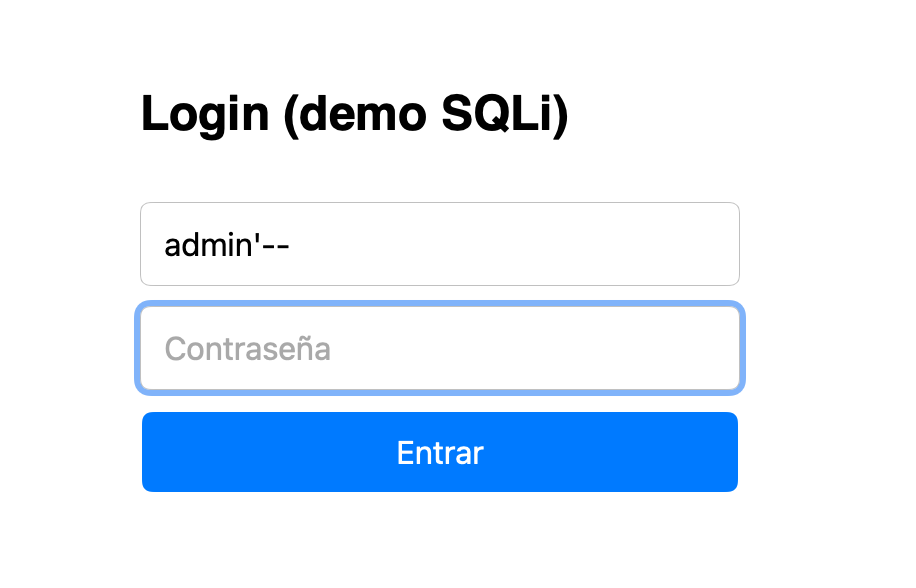
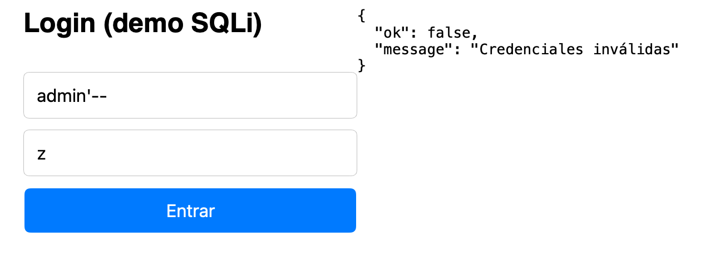
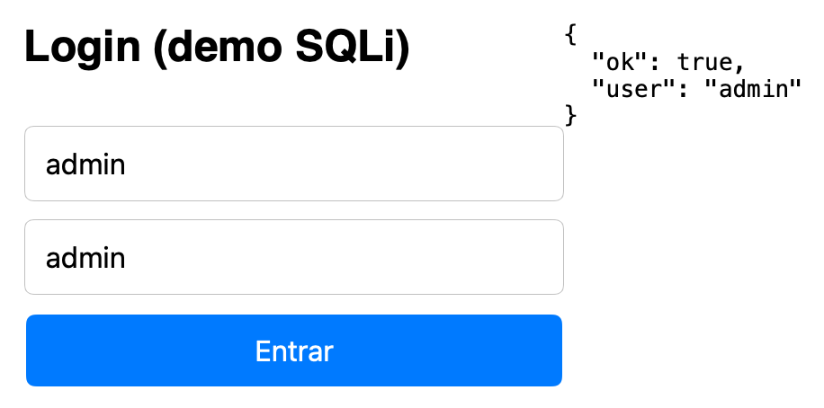
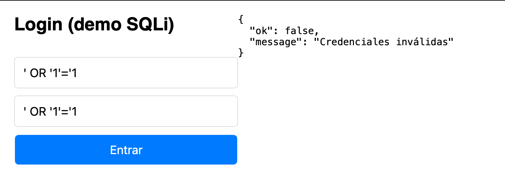

# Práctica - Login vulnerable a SQL Injection

Seguridad Informática, Facultad de Ingeniería (UACAM).

## De qué se trata

Es un login muy sencillo hecho con Node.js, Express y SQLite. La base de datos
vive en memoria y tiene dos usuarios de prueba:

| Usuario | Contraseña |
|---|---|
| `admin` | `admin` |
| `juan` | `1234` |

El formulario (`index.html`) manda el usuario y la contraseña al endpoint
`POST /login-vulnerable`, y el servidor busca en la tabla `users` una fila que
coincida con los dos. La versión original era vulnerable a inyección SQL, y lo
que hice fue corregirla con una consulta parametrizada.

## Cómo correrlo

```bash
npm install
node server-vulnerable.js
```

Luego se abre `http://localhost:3000` en el navegador.

## Cuál era el error

El servidor armaba la consulta pegando directamente lo que escribía el usuario
dentro del texto del SQL:

```js
const query = `SELECT * FROM users WHERE username = '${username}' AND password = '${password}'`;

db.get(query, (err, row) => {
```

El problema es que la base de datos recibe un solo texto y no tiene forma de
saber qué parte es código SQL y qué parte es el dato del usuario. Si alguien
escribe una comilla `'`, cierra la cadena antes de tiempo y todo lo que escriba
después se ejecuta como si fuera SQL.

### Ataque 1: `admin'--`

Con usuario `admin'--` y cualquier contraseña, la consulta quedaba así:

```sql
SELECT * FROM users WHERE username = 'admin'--' AND password = 'z'
```

La comilla cierra el nombre de usuario y `--` es un comentario en SQL, así que
todo lo que sigue se ignora, incluida la revisión de la contraseña. Lo que en
realidad se ejecutaba era:

```sql
SELECT * FROM users WHERE username = 'admin'
```

y se entraba como `admin` sin saber su contraseña.

### Ataque 2: `' OR '1'='1`

Poniendo `' OR '1'='1` en los dos campos quedaba:

```sql
SELECT * FROM users WHERE username = '' OR '1'='1' AND password = '' OR '1'='1'
```

Como `'1'='1'` siempre es verdadero, la condición se cumple para todas las
filas. `db.get` regresa la primera, que es `admin`, y otra vez se entraba sin
credenciales. Con este ni siquiera hace falta conocer un nombre de usuario.

## La corrección: consulta parametrizada

Cambié la consulta para que lleve `?` en lugar de los valores, y los valores se
pasan aparte en un arreglo:

```js
// Consulta parametrizada: los valores van aparte y nunca se mezclan con el SQL
const query = "SELECT * FROM users WHERE username = ? AND password = ?";

console.log("Query ejecutada:", query, [username, password]);

db.get(query, [username, password], (err, row) => {
```

Con esto la estructura de la consulta queda fija desde antes de saber qué
escribió el usuario. SQLite primero compila el SQL con los huecos y después mete
los valores como datos. Lo que escriba el usuario siempre se trata como texto,
aunque traiga comillas, `--`, `OR` o lo que sea. Por ejemplo, `admin'--` ya no
cierra nada, se busca un usuario que se llame literalmente `admin'--`, y como no
existe el login falla.

Una ventaja es que no hace falta escapar las comillas a mano ni filtrar
palabras como `OR` o `--`, que es fácil hacerlo mal y siempre aparece una forma
de saltarse el filtro.

## Pruebas

Probé desde el navegador con la versión ya parametrizada.

El formulario tiene los dos campos como `required`, así que si la contraseña se
deja vacía el navegador ni siquiera manda la petición. Para los ataques hay que
poner algo en la contraseña.



**Ataque `admin'--` con contraseña `z`:** ahora se rechaza.



**Login normal `admin` / `admin`:** sigue funcionando. Esto es importante
porque la corrección no debe romper a los usuarios legítimos.



**Ataque `' OR '1'='1` en los dos campos:** también se rechaza.



| Prueba | Antes | Después |
|---|---|---|
| `admin` / `admin` | Entra | Entra |
| `admin'--` / `z` | Entra como admin | Credenciales inválidas |
| `' OR '1'='1` / `' OR '1'='1` | Entra como admin | Credenciales inválidas |

## Lo que todavía se podría mejorar

La inyección SQL ya quedó resuelta, pero el login tiene otros problemas que no
eran parte de esta práctica:

* **Las contraseñas están en texto plano.** Si alguien saca la base de datos ve
  todas las contraseñas. Lo correcto es guardarlas con un hash lento como bcrypt
  o Argon2 y comparar contra el hash.
* **No hay límite de intentos.** Se pueden probar contraseñas por fuerza bruta
  sin que nada lo frene.
* **Se imprimen las contraseñas en consola.** El `console.log` muestra lo que
  escribió el usuario, contraseña incluida. Sirve para la demostración pero en
  un sistema real no se debe hacer.
* **El campo de contraseña es `type="text"`.** Se ve lo que se escribe; debería
  ser `type="password"`.
* **El nombre del archivo y la ruta siguen diciendo "vulnerable"**, aunque ya no
  lo son. Los dejé igual para no romper el formulario.

## Conclusión

El error venía de mezclar código y datos en el mismo texto. Mientras la
consulta se arme concatenando lo que escribe el usuario, siempre va a haber una
forma de cambiar su significado. La consulta parametrizada separa las dos cosas
y con eso los dos ataques dejaron de funcionar, mientras el login normal sigue
igual.

## Archivos

| Archivo | Qué es |
|---|---|
| `server-vulnerable.js` | El servidor con la consulta ya parametrizada |
| `index.html` | El formulario de login |
| `package.json` | Las dependencias (express y sqlite3) |
| `capturas/` | Capturas de las pruebas |
