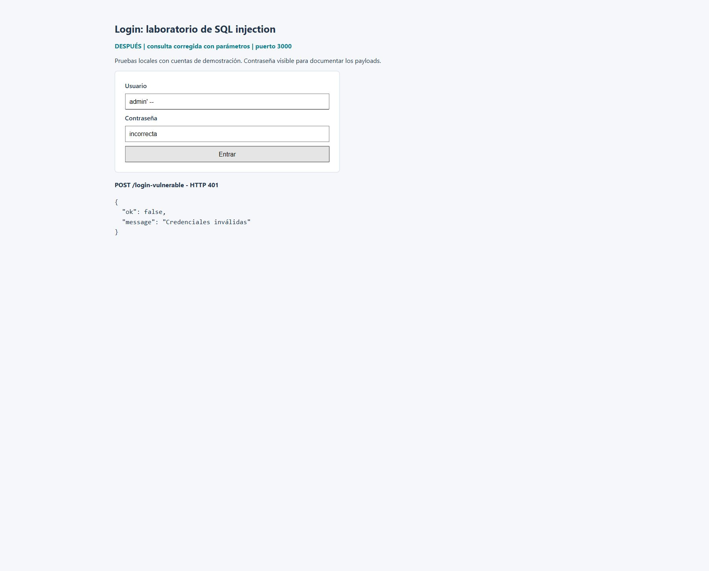
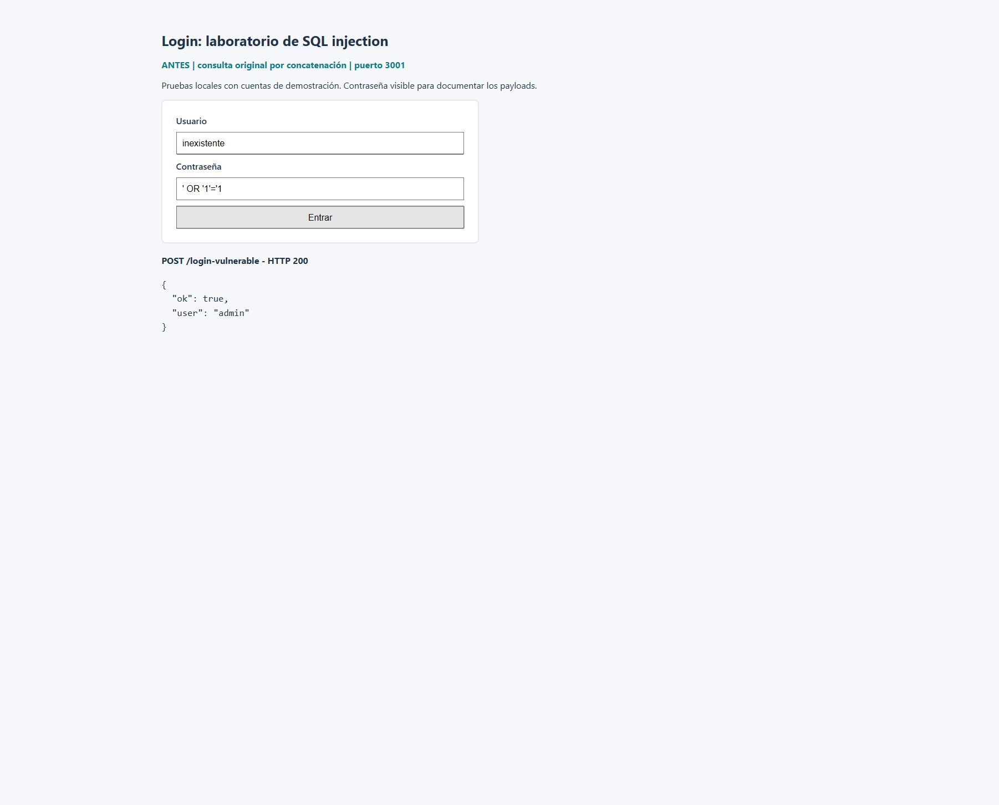
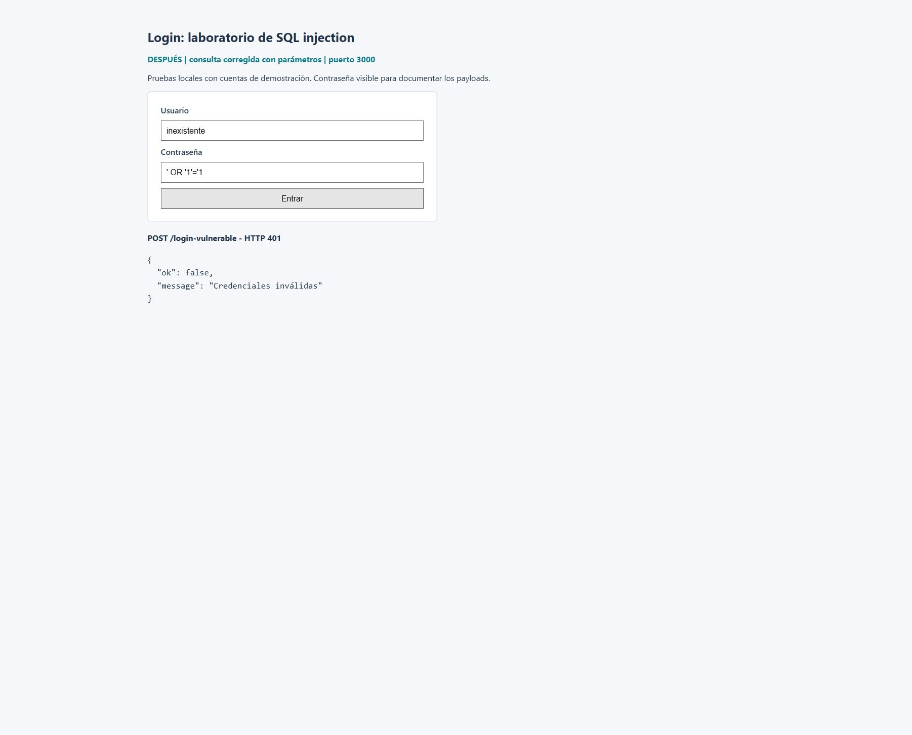
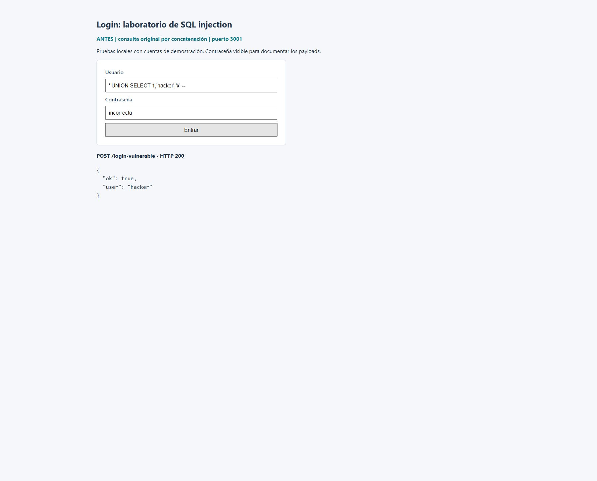
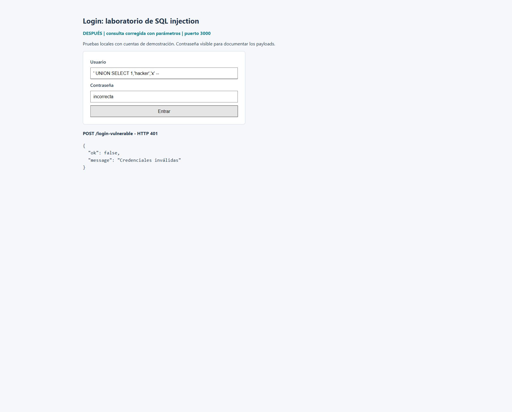
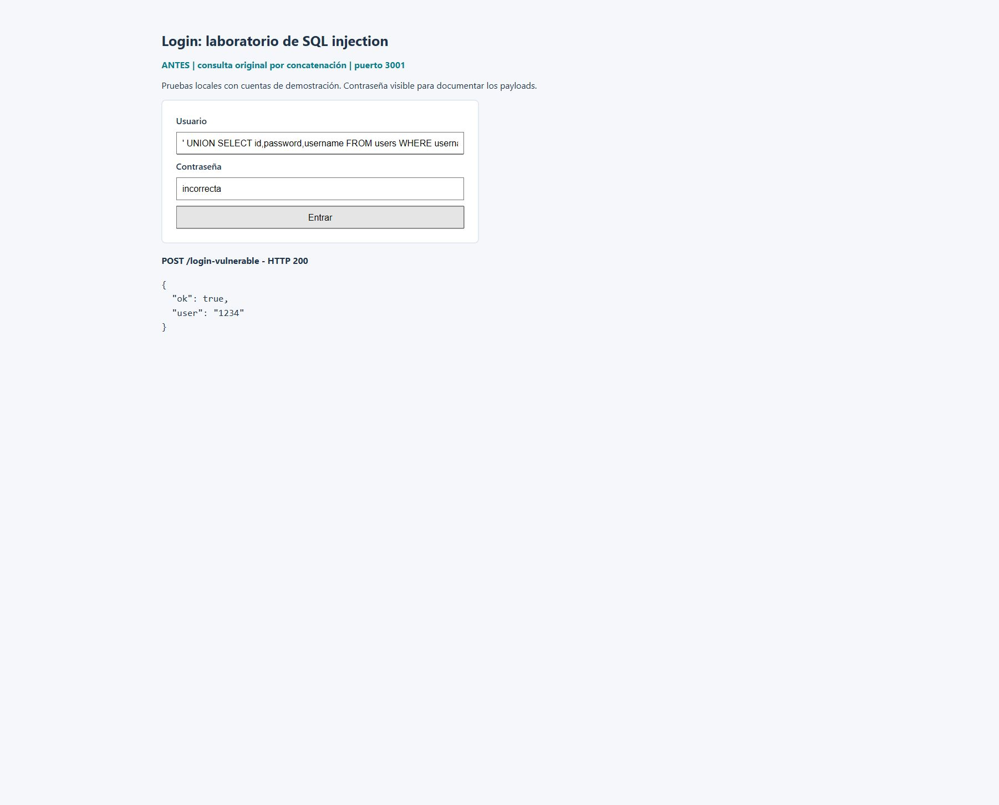
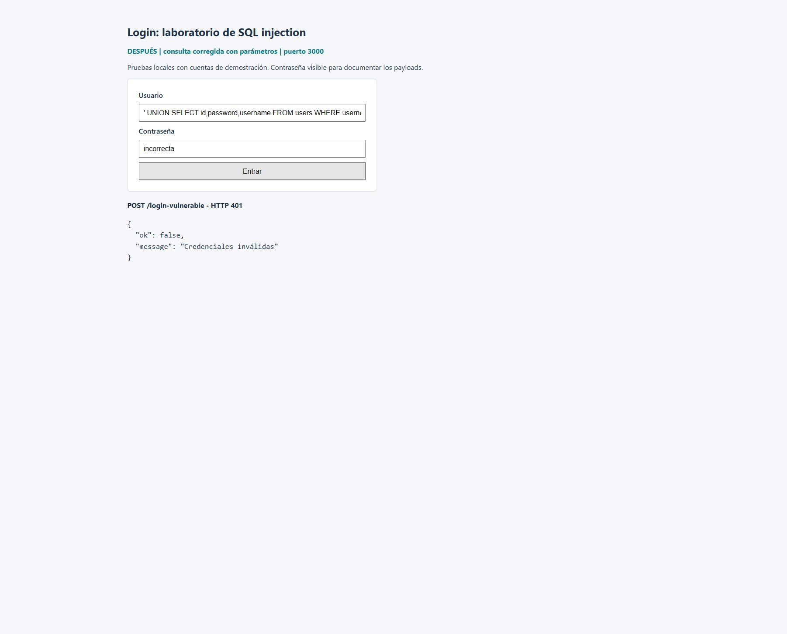
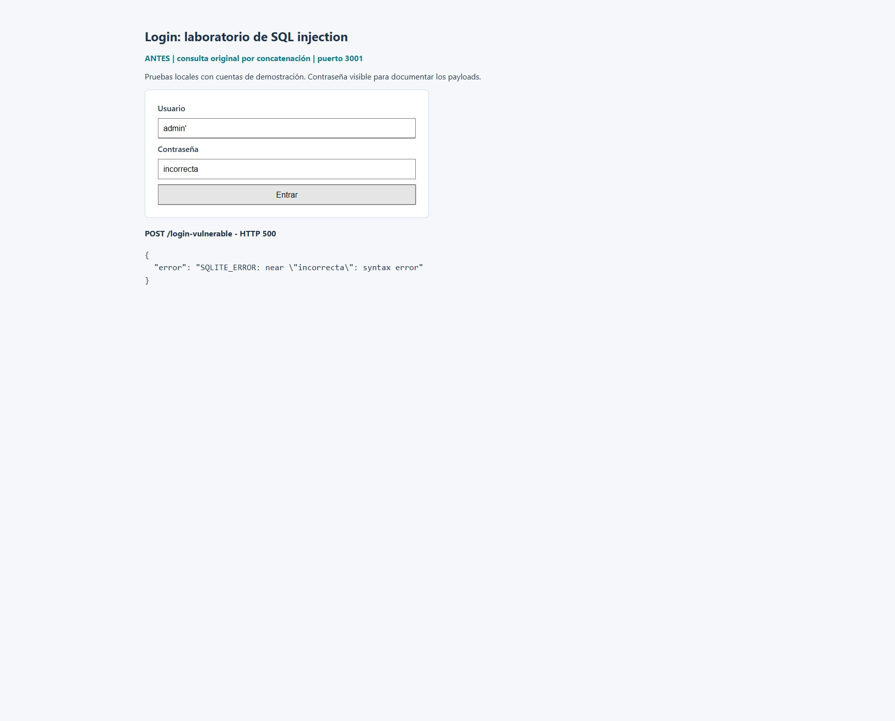

# Login: explotación y corrección de SQL injection

David Cervantes Malfavon | Matrícula: 72966

## Qué cambió y qué comprobé

El login original aceptaba entradas que modificaban su consulta SQL. Al repetir 16 casos antes y después de corregirlo, 12 consiguieron acceso indebido en la versión original, tres provocaron errores del motor y uno fue rechazado como control. Con parámetros, los 16 casos recibieron HTTP 401 y los accesos válidos de admin y juan siguieron funcionando.

## Entorno y procedimiento

Trabajé con Express y SQLite en memoria del repositorio del profesor. Las pruebas se ejecutaron en localhost con las cuentas de demostración admin/admin y juan/1234. La versión corregida usa el puerto 3000 y la original de laboratorio, el 3001.

La referencia original es el commit c3d7fa16fdd6447ed29866f636e86fc8dd025721. Para repetir la comparación se conservaron su consulta y sus respuestas; solo se adaptaron el puerto, la escucha local y la entrega del formulario. El formulario se ajustó para mostrar la versión y el estado HTTP en las capturas.

Fuente del código: https://github.com/sanp-uacam/SeguridadInformatica

## Resultados de los 16 casos

La tabla muestra el campo donde se colocó cada entrada. En los ataques al usuario, la contraseña fue incorrecta. En P07 y P12 el usuario fue inexistente; en P08 se usó juan. Los espacios finales después de -- forman parte de las entradas del archivo de pruebas.

200: la aplicación devolvió ok: true. 401: credenciales inválidas. 500: error SQL devuelto al cliente. En P09 apareció el usuario inventado hacker; en P10 apareció 1234, la contraseña de juan, en el campo user de la respuesta.

| Caso | Técnica | Usuario | Contraseña | Antes | Después |
|---|---|---|---|---|---|
| P01 | Comentario | `admin' -- ` | `incorrecta` | 200 | 401 |
| P02 | Comentario con otro usuario | `juan' -- ` | `incorrecta` | 200 | 401 |
| P03 | Comentario sin espacio previo | `admin'--` | `incorrecta` | 200 | 401 |
| P04 | Tautología numérica | `' OR 1=1 -- ` | `incorrecta` | 200 | 401 |
| P05 | Tautología de texto | `' OR '1'='1' -- ` | `incorrecta` | 200 | 401 |
| P06 | Tautología con usuario | `admin' OR '1'='1' -- ` | `incorrecta` | 200 | 401 |
| P07 | Inyección en contraseña | `inexistente` | `' OR '1'='1` | 200 | 401 |
| P08 | Contraseña y comentario | `juan` | `x' OR 1=1 -- ` | 200 | 401 |
| P09 | UNION: usuario inventado | `' UNION SELECT 1,'hacker','x' -- ` | `incorrecta` | 200 | 401 |
| P10 | UNION: extracción de contraseña | `' UNION SELECT id,password,username FROM users WHERE username='juan' -- ` | `incorrecta` | 200 | 401 |
| P11 | Comentario y condición | `' OR 2>1 -- ` | `incorrecta` | 200 | 401 |
| P12 | Contraseña: comparación numérica | `inexistente` | `' OR 7=7 -- ` | 200 | 401 |
| P13 | Comilla suelta: fuga de error | `admin'` | `incorrecta` | 500 | 401 |
| P14 | UNION con columnas incorrectas | `' UNION SELECT 1 -- ` | `incorrecta` | 500 | 401 |
| P15 | Comentario de MySQL no válido | `admin'#` | `incorrecta` | 500 | 401 |
| P16 | Condición falsa de control | `' OR 1=0 -- ` | `incorrecta` | 401 | 401 |
## Por qué funcionaban los ataques

El problema estaba en pegar las entradas dentro de la instrucción SQL. Una comilla enviada en el formulario podía cerrar el texto antes de tiempo y permitir que el resto se interpretara como código.

```
const query = `SELECT * FROM users WHERE username = '${username}'
  AND password = '${password}'`;
```

El salto de línea del fragmento solo facilita la lectura de la consulta original.

### Comentario: quitar la comprobación de contraseña

En P01, admin' -- cierra el usuario con una comilla y convierte el resto de la línea en comentario. La condición efectiva queda limitada al usuario admin. P02 repite el efecto con juan; P03 comprueba una variante sin espacio antes del comentario.

```
SELECT * FROM users WHERE username = 'admin' -- ' AND password = 'incorrecta'
```

### Tautologías: volver verdadera la condición

P04, P05, P06 y P11 agregan comparaciones verdaderas, como 1=1 o 2>1. P07, P08 y P12 aprovechan la misma concatenación desde la contraseña. En P07, AND tiene prioridad sobre OR, así que la comparación final verdadera permite devolver una fila aunque el usuario no exista.

```
SELECT * FROM users
WHERE username = 'inexistente' AND password = '' OR '1'='1'
```

### UNION: inventar una fila o cambiar los datos devueltos

P09 agrega un SELECT de tres columnas, igual que la tabla users: id, username y password. La aplicación recibe una fila fabricada y responde con user: hacker. Esto demuestra aceptación de una fila inexistente; el programa no implementa sesiones persistentes.

P10 coloca password en la segunda columna del SELECT agregado. Como la respuesta toma row.username de esa posición, termina mostrando 1234. No solo se evita la contraseña: también se puede exponer un dato de la tabla de demostración.

### Errores y control negativo

P13 desbalancea las comillas; P14 usa UNION con un número incorrecto de columnas y P15 intenta usar # como comentario, lo que SQLite rechaza. Los tres producen HTTP 500 y revelan información del motor, pero no consiguen acceso. P16 usa una condición falsa y devuelve 401 desde el inicio.

## La corrección y las validaciones

La consulta ahora mantiene una estructura fija. Los marcadores ? reciben el usuario y la contraseña como valores separados mediante el arreglo de parámetros de sqlite3. Las comillas, UNION y los comentarios enviados desde el formulario ya no se convierten en instrucciones.

```
const query =
  'SELECT username FROM users WHERE username = ? AND password = ?';
db.get(query, [username, password], (error, row) => {
  if (error) return res.status(500).json({
    ok: false, message: 'Error interno del servidor'
  });
  if (row) return res.json({ ok: true, user: row.username });
  return res.status(401).json({
    ok: false, message: 'Credenciales inválidas'
  });
});
```

### Controles que acompañan a los parámetros

Se exige que los dos campos sean texto, contengan algún carácter distinto de espacios y no excedan 100 caracteres. Se rechazan datos ausentes, null, arreglos y objetos con HTTP 400. Las entradas de hasta 100 caracteres sí llegan a la comparación de credenciales.

La contraseña se compara exactamente como se recibe: no se recortan espacios para intentar convertir una contraseña incorrecta en una válida. La validación limita entradas inesperadas; la parametrización es la que resuelve la inyección SQL.

El cuerpo JSON tiene un límite de 8 KB. Un JSON mal formado recibe 400 y un cuerpo demasiado grande recibe 413, con mensajes controlados. Los errores de la base ya no se envían al navegador. La consulta selecciona solo username, que es el dato utilizado en la respuesta.

El servidor entrega únicamente el formulario por sus rutas previstas, en lugar de publicar toda la carpeta. Se comprobó que /server-vulnerable.js responde 404. Ambos servidores escuchan en 127.0.0.1 para esta práctica local.

### Compatibilidad con el proyecto

El archivo server-vulnerable.js conserva su nombre original, pero contiene la versión corregida. La ruta /login-vulnerable continúa conectada con el formulario; /login-seguro es un alias con la misma lógica. La consulta vulnerable se conserva aparte, en laboratorio/server-original.js, para reproducir el antes y después.

## Verificación, reproducción y conclusiones

Resultado del registro: 45 pruebas aprobadas, 0 fallidas y 0 omitidas. La comparación independiente ejecuta 32 solicitudes para los 16 casos y verifica tanto el estado como los resultados de la versión original. Los registros completos se incluyen en evidencias/.

### Cómo repetirlo desde la carpeta login

```
npm ci
npm test
npm run compare
npm start
# En otra terminal, para la comparación visual:
npm run lab:vulnerable
```

npm test usa un puerto local disponible y cierra sus recursos. npm run compare necesita libre el puerto 3001, inicia ambas versiones y las cierra al terminar. Para las capturas manuales se abren http://127.0.0.1:3000 y http://127.0.0.1:3001.

### Conclusiones

Los resultados muestran que el defecto no dependía de una sola cadena: permitía comentarios, condiciones verdaderas, filas inventadas y exposición de datos. La misma consulta parametrizada rechazó las entradas probadas sin impedir el acceso de las dos cuentas válidas.

La comparación también permitió separar los resultados: provocar un error no equivale a iniciar sesión. La versión corregida dejó de aceptar los 12 accesos indebidos y de revelar errores en los otros tres casos.

El alcance sigue siendo un laboratorio: hay contraseñas de demostración en texto plano y no existe una sesión persistente. Para una aplicación real todavía harían falta almacenamiento de contraseñas con hash y controles de sesión, entre otras medidas. Las pruebas verifican los casos descritos, no toda la seguridad de una aplicación.

## Evidencia 1 | comentario SQL

Antes: P01 entra como admin con una contraseña incorrecta (HTTP 200).


Después: el mismo texto se trata como dato y recibe HTTP 401.



## Evidencia 2 | inyección en contraseña

Antes: P07 acepta la condición verdadera desde la contraseña (HTTP 200).



Después: la misma entrada se rechaza; el usuario inexistente no obtiene acceso.



## Evidencia 3 | usuario inventado con UNION

Antes: P09 fabrica una fila y la aplicación responde user: hacker (HTTP 200).



Después: la entrada UNION no modifica la consulta y recibe HTTP 401.



## Evidencia 4 | exposición de un dato

Antes: P10 hace aparecer la contraseña de juan, 1234, en el campo user.



Después: la consulta parametrizada rechaza esa entrada y no devuelve el dato.



## Evidencia 5 | fuga de errores SQL

Antes: P13 devuelve HTTP 500 con un mensaje interno de SQLite.



Después: esa comilla es un dato literal y la respuesta es HTTP 401.


