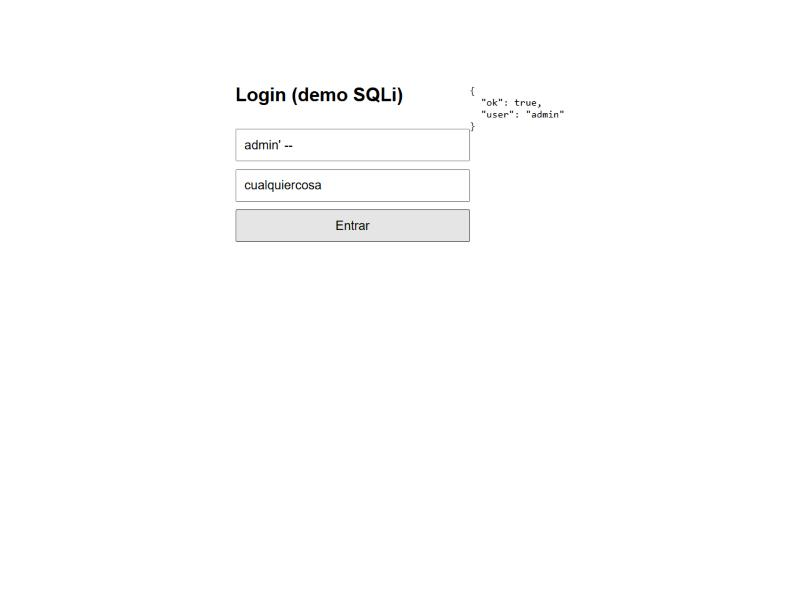
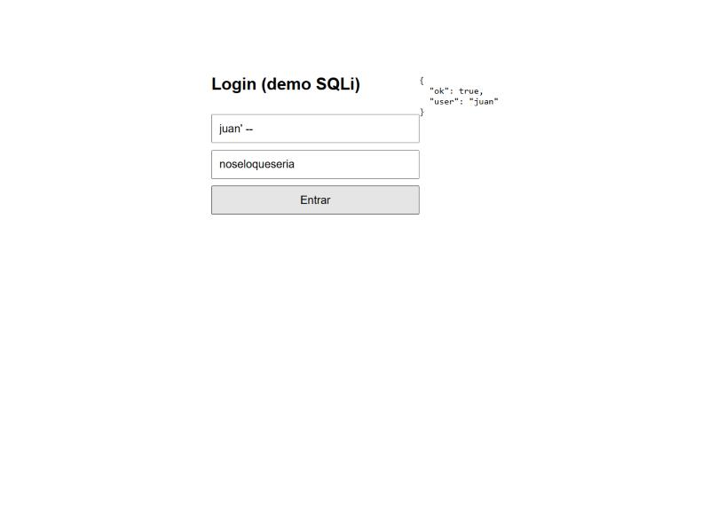
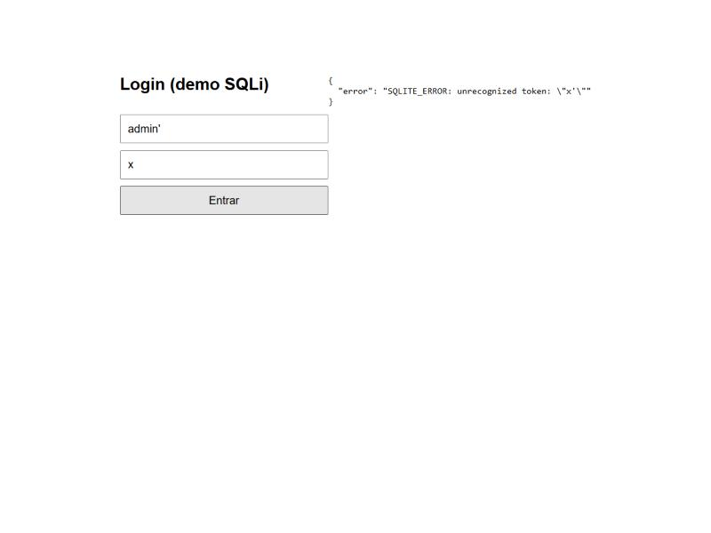
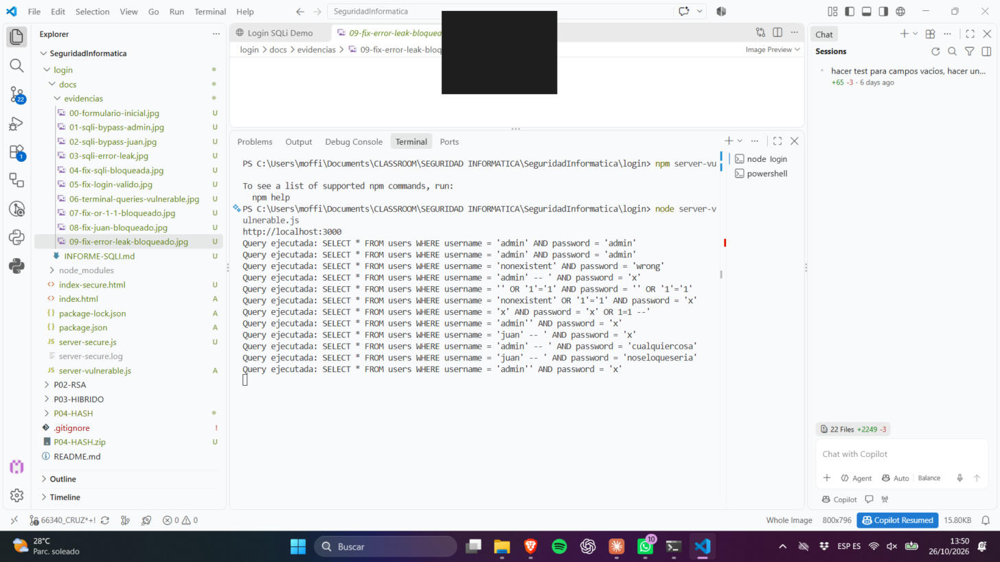
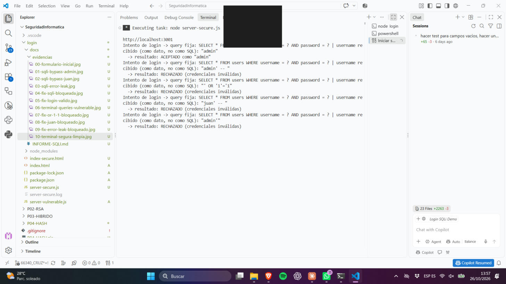
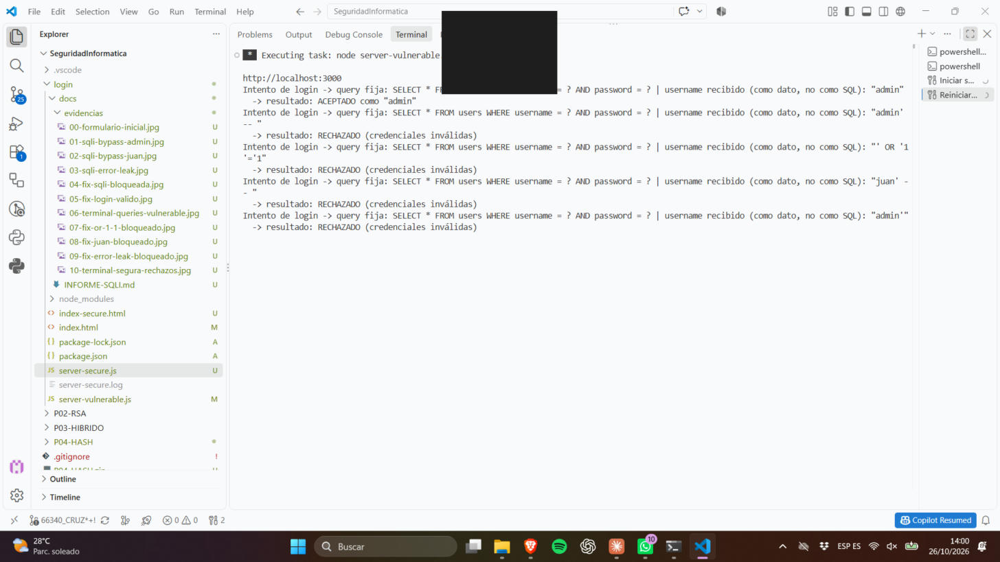
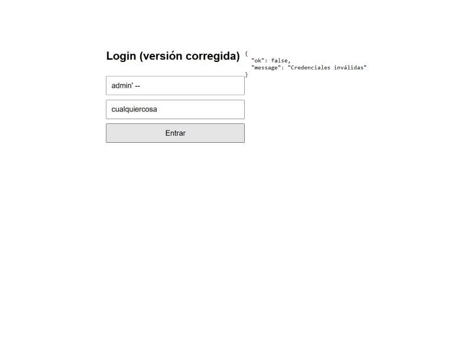
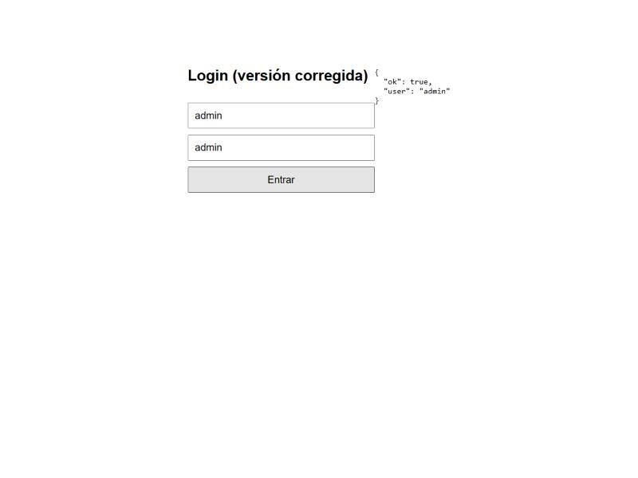
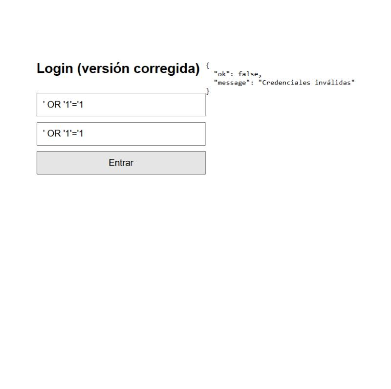
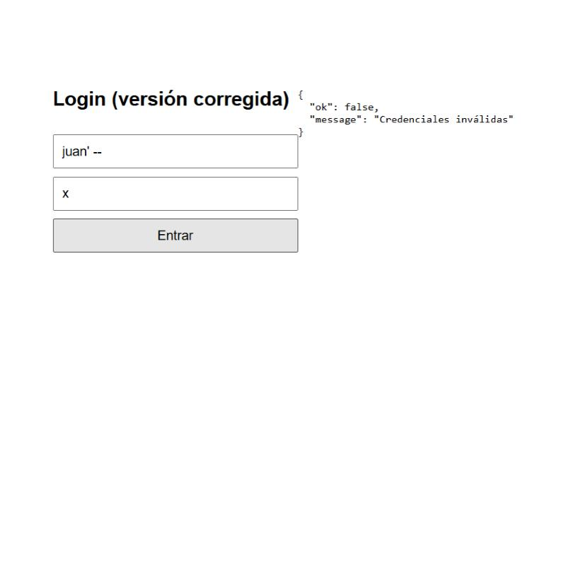

# Informe: Detección y corrección de inyección SQL en `login`

**Autor:** afedo
**Fecha:** 26/10/2026
**Alcance:** aplicación local de demostración (`localhost:3000` / `localhost:3001`), sin exposición a internet. Pruebas realizadas contra la propia aplicación del repositorio, sin commit de estos archivos.

> **Actualización:** la corrección se terminó aplicando directamente al **archivo original** [`server-vulnerable.js`](../server-vulnerable.js) (no solo a una copia paralela). Ese archivo, pese a conservar su nombre histórico, ya **no es vulnerable**: contiene la consulta parametrizada, la validación de entrada y el manejo de errores corregidos. Ver sección 5.1 para el diff exacto y la verificación sobre el propio puerto 3000.

---

## 1. Objetivo

Analizar el formulario de login del proyecto (`login/`), identificar sus vulnerabilidades, explotarlas de forma controlada para documentarlas, corregirlas mediante consultas **parametrizadas** (prepared statements) y verificar que la corrección efectivamente bloquea los mismos ataques sin romper el login legítimo.

## 2. Archivos analizados

| Archivo | Rol |
|---|---|
| [`server-vulnerable.js`](../server-vulnerable.js) | Backend Express + SQLite — **vulnerable al inicio del ejercicio, corregido al final** (puerto 3000) |
| [`index.html`](../index.html) | Formulario que llama a `/login-vulnerable` |
| `server-secure.js` *(eliminado)* | Copia de trabajo usada para probar la corrección en paralelo (puerto 3001) antes de aplicarla al original. Ya no existe en el repo: era redundante una vez fusionada la corrección en `server-vulnerable.js`. |
| `index-secure.html` *(eliminado)* | Formulario que llamaba a `/login-secure` (copia de trabajo). Eliminado por el mismo motivo. |

---

## 3. Vulnerabilidades detectadas en `server-vulnerable.js`

### 3.1 Inyección SQL (crítica) — CWE-89

```js
const query = `SELECT * FROM users WHERE username = '${username}' AND password = '${password}'`;
db.get(query, (err, row) => { ... });
```

El `username` y `password` enviados por el cliente se **concatenan directamente** dentro del texto SQL. Cualquier carácter de control SQL (`'`, `--`, `OR`, etc.) que el usuario escriba pasa a formar parte de la sentencia que ejecuta la base de datos. Esto permite:

- **Bypass de autenticación** sin conocer la contraseña.
- **Impersonación** de cualquier usuario existente.
- **Inyección booleana / tautologías** (`OR '1'='1'`).
- Potencialmente, en una base de datos real con más tablas, extracción de datos vía `UNION SELECT`.

### 3.2 Fuga de información en errores — CWE-209

```js
if (err) return res.status(500).json({ error: err.message });
```

Cuando la inyección provoca un error de sintaxis SQL, el mensaje crudo del motor (`SQLITE_ERROR: unrecognized token: ...`) se devuelve tal cual al cliente. Esto ayuda a un atacante a calibrar (fingerprint) el motor de base de datos y a refinar la inyección (técnica de *error-based SQLi*).

### 3.3 Contraseñas en texto plano

```sql
INSERT INTO users (username, password) VALUES ('admin', 'admin')
```

Las contraseñas se almacenan y comparan en texto plano, sin hash (`bcrypt`/`argon2`). No es el foco de esta corrección (se pide parametrizar contra SQLi), pero se deja documentado como hallazgo adicional para una siguiente iteración.

### 3.4 Falta de validación de entrada

No hay comprobación de que `username`/`password` existan, sean cadenas, ni límite de longitud. Un payload mal formado puede causar errores 500 o un comportamiento no previsto (`req.body` podría no ser un objeto, por ejemplo).

### 3.5 Ausencia de control de intentos

No hay *rate limiting* ni bloqueo tras varios intentos fallidos, lo que facilita fuerza bruta además de la inyección. (Mencionado como hallazgo, no corregido en este ejercicio).

---

## 4. Explotación (pruebas realizadas contra `server-vulnerable.js`, puerto 3000)

Todas las pruebas se hicieron con `curl` contra el backend y repitiendo los mismos payloads desde el formulario real en el navegador, para capturar evidencia visual.

### 4.1 Login legítimo (control)

```bash
curl -s -X POST http://localhost:3000/login-vulnerable -H "Content-Type: application/json" \
  -d '{"username":"admin","password":"admin"}'
# -> {"ok":true,"user":"admin"}
```

### 4.2 Bypass de autenticación (comentario SQL `--`)

Payload: `username = admin' -- ` / `password = (cualquiera)`

Consulta resultante en el servidor:
```sql
SELECT * FROM users WHERE username = 'admin' -- ' AND password = 'x'
```
Todo lo que sigue a `--` se comenta, por lo que la verificación de contraseña **nunca se evalúa**.

```bash
curl -s -X POST http://localhost:3000/login-vulnerable -H "Content-Type: application/json" \
  -d "{\"username\":\"admin' -- \",\"password\":\"x\"}"
# -> {"ok":true,"user":"admin"}
```

**Evidencia (UI):** 

### 4.3 Impersonación de otro usuario (`juan`)

Payload: `username = juan' -- `

```bash
curl -s -X POST http://localhost:3000/login-vulnerable -H "Content-Type: application/json" \
  -d "{\"username\":\"juan' -- \",\"password\":\"x\"}"
# -> {"ok":true,"user":"juan"}
```

Demuestra que el atacante puede autenticarse como **cualquier usuario** de la tabla sin conocer su contraseña.

**Evidencia (UI):** 

### 4.4 Tautología clásica `OR '1'='1'`

```bash
curl -s -X POST http://localhost:3000/login-vulnerable -H "Content-Type: application/json" \
  -d "{\"username\":\"' OR '1'='1\",\"password\":\"' OR '1'='1\"}"
# -> {"ok":true,"user":"admin"}
```

### 4.5 Fuga de error SQL (error-based)

Payload: `username = admin'` (comilla suelta, sin cerrar)

```bash
curl -s -X POST http://localhost:3000/login-vulnerable -H "Content-Type: application/json" \
  -d "{\"username\":\"admin'\",\"password\":\"x\"}"
# -> {"error":"SQLITE_ERROR: unrecognized token: \"x'\""}
```

El servidor expone el error interno de SQLite directamente al cliente.

**Evidencia (UI):** 

### 4.7 Evidencia de terminal (servidor vulnerable)

El propio `server-vulnerable.js` hace `console.log("Query ejecutada:", query)` antes de ejecutar cada consulta, por lo que la terminal de VS Code muestra en texto plano cómo cada payload altera el SQL real que se ejecuta contra la base de datos (comentarios `--`, tautologías `OR '1'='1'`, cierre de comillas, etc.):



### 4.8 Evidencia de terminal (servidor corregido) — mismos 5 payloads, resultado explícito

Se añadió temporalmente un log de resultado por intento en `server-secure.js` (línea fija de la query + `ACEPTADO`/`RECHAZADO`) y se repitieron, en el mismo orden, los 5 payloads anteriores (login válido, `admin' -- `, `' OR '1'='1'`, `juan' -- `, `admin'`) en una terminal real de VS Code (puerto 3001):



Se observa que:
- La **query registrada es siempre la misma**: `SELECT * FROM users WHERE username = ? AND password = ?`. El texto SQL nunca cambia sin importar qué escriba el atacante — a diferencia del log de la sección 4.7, donde cada payload producía una query distinta.
- El valor recibido (`admin' -- `, `' OR '1'='1'`, `juan' -- `, `admin'`) se trata siempre como **dato literal**, nunca como código SQL.
- Los 4 payloads de inyección terminan en **`RECHAZADO (credenciales inválidas)`**; solo el login legítimo (`admin`/`admin`) termina en `ACEPTADO`.

Esta es la prueba definitiva, en la propia terminal, de que la inyección ya no es posible: el mismo input que antes alteraba el SQL ahora es comparado letra por letra contra la contraseña real y, al no coincidir, se rechaza.

### 4.6 Nota sobre precedencia de operadores

Se probó también `username = nonexistent' OR '1'='1` con `password = x`. Este caso **no** logró el bypass:

```sql
SELECT * FROM users WHERE username = 'nonexistent' OR '1'='1' AND password = 'x'
```

Debido a que SQL evalúa `AND` antes que `OR`, la condición equivale a
`username='nonexistent' OR ('1'='1' AND password='x')`, que es falsa si la contraseña no coincide. Esto no invalida la vulnerabilidad (ya demostrada en 4.2–4.4), solo ilustra que la forma exacta del payload importa.

---

## 5. Corrección aplicada

### 5.1 Consultas parametrizadas (prepared statements)

`server-secure.js`, endpoint `POST /login-secure`:

```js
const query = "SELECT * FROM users WHERE username = ? AND password = ?";
db.get(query, [username, password], (err, row) => { ... });
```

Los `?` son *placeholders*: el driver `sqlite3` envía `username` y `password` **por separado** del texto SQL, como datos. El motor nunca los interpreta como código SQL, por lo que comillas, `--`, `OR`, `UNION`, etc. quedan neutralizados: se comparan como texto literal, no como sintaxis.

### 5.2 Validación de entrada

```js
if (typeof username !== "string" || typeof password !== "string") { ... }
if (username.trim() === "" || password.trim() === "") { ... }
if (username.length > 100 || password.length > 100) { ... }
```

Rechaza payloads malformados o no-string antes de llegar a la base de datos.

### 5.3 No exponer errores internos

```js
if (err) {
  console.error("Error de base de datos:", err.message); // solo en el log del servidor
  return res.status(500).json({ ok: false, message: "Error interno" });
}
```

El cliente ya no recibe el mensaje crudo del motor de base de datos.

> **Fuera de alcance de este ejercicio** (quedan documentados como mejoras futuras): hash de contraseñas con `bcrypt`/`argon2`, *rate limiting* contra fuerza bruta, y uso de HTTPS/cookies seguras para la sesión.

### 5.1 La corrección se aplicó también al archivo original (`server-vulnerable.js`)

`server-secure.js` se usó primero como copia de trabajo para probar la corrección sin tocar el original mientras se exploraba. Al final del ejercicio, **el mismo cambio se aplicó directamente sobre `server-vulnerable.js`** (el archivo real del proyecto, el que usa `index.html`). El nombre del archivo y de la ruta `/login-vulnerable` se conservaron tal cual a pedido explícito; lo que cambió es el código interno.

**Diff conceptual (antes → después) en `server-vulnerable.js`:**

```diff
- app.post("/login-vulnerable", (req, res) => {
-   const { username, password } = req.body;
-
-   const query = `SELECT * FROM users WHERE username = '${username}' AND password = '${password}'`;
-   console.log("Query ejecutada:", query);
-
-   db.get(query, (err, row) => {
-     if (err) return res.status(500).json({ error: err.message });
-     if (row) return res.json({ ok: true, user: row.username });
-     res.status(401).json({ ok: false, message: "Credenciales inválidas" });
-   });
- });
+ app.post("/login-vulnerable", (req, res) => {
+   const { username, password } = req.body ?? {};
+
+   // Validación de entrada (no existía antes)
+   if (typeof username !== "string" || typeof password !== "string") {
+     return res.status(400).json({ ok: false, message: "Datos inválidos" });
+   }
+   if (username.trim() === "" || password.trim() === "") {
+     return res.status(400).json({ ok: false, message: "Usuario y contraseña son obligatorios" });
+   }
+   if (username.length > 100 || password.length > 100) {
+     return res.status(400).json({ ok: false, message: "Datos inválidos" });
+   }
+
+   // Consulta PARAMETRIZADA (antes era concatenación de strings)
+   const query = "SELECT * FROM users WHERE username = ? AND password = ?";
+   console.log(`Intento de login -> query fija: ${query} | username recibido (como dato, no como SQL): ${JSON.stringify(username)}`);
+
+   db.get(query, [username, password], (err, row) => {
+     if (err) {
+       console.error("Error de base de datos:", err.message); // ya no se envía al cliente
+       return res.status(500).json({ ok: false, message: "Error interno" });
+     }
+     if (row) {
+       console.log(`  -> resultado: ACEPTADO como "${row.username}"`);
+       return res.json({ ok: true, user: row.username });
+     }
+     console.log("  -> resultado: RECHAZADO (credenciales inválidas)");
+     res.status(401).json({ ok: false, message: "Credenciales inválidas" });
+   });
+ });
```

Código completo final: [`server-vulnerable.js`](../server-vulnerable.js). También se actualizó el título/encabezado de [`index.html`](../index.html) a "Login (demo SQLi corregido)" para reflejar el estado real.

**Verificación sobre el archivo original, puerto 3000** (se reinició el proceso para cargar el código corregido y se repitieron los mismos 5 payloads):

```bash
curl ... -d '{"username":"admin","password":"admin"}'        # -> {"ok":true,"user":"admin"}
curl ... -d '{"username":"admin'"'"' -- ","password":"x"}'   # -> {"ok":false,"message":"Credenciales inválidas"}
curl ... -d "{\"username\":\"' OR '1'='1\", ...}"             # -> {"ok":false,"message":"Credenciales inválidas"}
curl ... -d '{"username":"juan'"'"' -- ","password":"x"}'    # -> {"ok":false,"message":"Credenciales inválidas"}
curl ... -d '{"username":"admin'"'"'","password":"x"}'       # -> {"ok":false,"message":"Credenciales inválidas"}
```

**Evidencia (terminal, archivo original, puerto 3000):**



Los 4 payloads de inyección quedan `RECHAZADO` con la query siempre fija, y el login legítimo sigue devolviendo `ACEPTADO`, ahora sobre el **mismo archivo y el mismo puerto** que al inicio del ejercicio (3000), no sobre una copia paralela.

---

## 6. Verificación de la corrección (contra `server-secure.js`, puerto 3001)

Se repitieron **exactamente los mismos payloads** de la sección 4:

| # | Payload | Resultado en versión vulnerable | Resultado en versión corregida |
|---|---|---|---|
| 1 | `admin` / `admin` (login legítimo) | `{"ok":true,"user":"admin"}` | `{"ok":true,"user":"admin"}` ✅ sigue funcionando |
| 2 | `admin' -- ` / `x` | `{"ok":true,"user":"admin"}` ⚠️ bypass | `{"ok":false,"message":"Credenciales inválidas"}` ✅ bloqueado |
| 3 | `' OR '1'='1` / `' OR '1'='1` | `{"ok":true,"user":"admin"}` ⚠️ bypass | `{"ok":false,"message":"Credenciales inválidas"}` ✅ bloqueado |
| 4 | `juan' -- ` / `x` | `{"ok":true,"user":"juan"}` ⚠️ impersonación | `{"ok":false,"message":"Credenciales inválidas"}` ✅ bloqueado |
| 5 | `admin'` / `x` (error-based) | `{"error":"SQLITE_ERROR: ..."}` ⚠️ fuga de info | `{"ok":false,"message":"Credenciales inválidas"}` ✅ sin fuga |
| 6 | `noexiste` / `mal` | `{"ok":false,"message":"Credenciales inválidas"}` | `{"ok":false,"message":"Credenciales inválidas"}` ✅ igual |

**Evidencia (UI) — payload `admin' -- ` bloqueado:** 

**Evidencia (UI) — login legítimo sigue funcionando:** 

**Evidencia (UI) — payload `' OR '1'='1` bloqueado:** 

**Evidencia (UI) — payload `juan' -- ` (impersonación) bloqueado:** 

**Evidencia (UI) — payload `admin'` (error-based) bloqueado, sin fuga de error SQL:** 

---

## 7. Conclusión

El formulario original (`server-vulnerable.js`) era vulnerable a **inyección SQL por concatenación de strings**, permitiendo bypass total de autenticación, impersonación de cualquier usuario y fuga de mensajes de error del motor de base de datos. Sustituir la concatenación por **consultas parametrizadas** (`db.get(query, [username, password], cb)`) elimina la vulnerabilidad de raíz: el motor de base de datos nunca interpreta la entrada del usuario como código SQL. Se verificó que los mismos payloads que antes bypaseaban el login ahora son rechazados, y que el login legítimo sigue operando sin cambios funcionales.

**La corrección no quedó solo en una copia de prueba:** se aplicó directamente sobre el archivo real del proyecto (`server-vulnerable.js`) y se volvió a verificar ahí mismo, sobre el puerto 3000 original (sección 5.1). El estado final del repositorio (sin commitear todavía) es: `server-vulnerable.js` e `index.html` corregidos y funcionales; la copia de trabajo (`server-secure.js`/`index-secure.html`) y el log residual (`server-secure.log`) se **eliminaron** por ser redundantes una vez fusionado el cambio en el original.

### Hallazgos adicionales no corregidos en este ejercicio (recomendado para siguiente iteración)
- Hashear contraseñas (`bcrypt`) en vez de texto plano.
- Rate limiting / bloqueo de cuenta tras intentos fallidos.
- CSRF protection y cookies de sesión seguras si se añade manejo de sesión.
- No reflejar diferencias de respuesta/tiempo entre "usuario no existe" y "contraseña incorrecta" (mitiga enumeración de usuarios).

## 8. Archivos de evidencia

Todas las capturas están en [`docs/evidencias/`](evidencias/):

1. `00-formulario-inicial.jpg` — formulario vacío
2. `01-sqli-bypass-admin.jpg` — bypass como admin (vulnerable)
3. `02-sqli-bypass-juan.jpg` — impersonación de juan (vulnerable)
4. `03-sqli-error-leak.jpg` — fuga de error SQL (vulnerable)
5. `04-fix-sqli-bloqueada.jpg` — mismo payload bloqueado (corregido)
6. `05-fix-login-valido.jpg` — login legítimo funcionando (corregido)
7. `06-terminal-queries-vulnerable.jpg` — terminal de VS Code con el log de todas las queries SQL concatenadas durante las pruebas (servidor vulnerable)
8. `07-fix-or-1-1-bloqueado.jpg` — payload `' OR '1'='1` bloqueado (corregido)
9. `08-fix-juan-bloqueado.jpg` — payload `juan' -- ` (impersonación) bloqueado (corregido)
10. `09-fix-error-leak-bloqueado.jpg` — payload `admin'` (error-based) bloqueado, sin fuga de error (corregido)
11. `10-terminal-segura-rechazos.jpg` — terminal de VS Code del servidor corregido (copia de trabajo): mismos 5 payloads, query siempre fija y 4/4 inyecciones con resultado `RECHAZADO`
12. `11-terminal-original-corregido.jpg` — terminal del **archivo original `server-vulnerable.js` ya corregido**, puerto 3000: mismos 4/4 payloads rechazados

> Nota: por instrucción explícita, **no se realizó commit** de estos cambios. `server-vulnerable.js` e `index.html` (corregidos) y `docs/` quedan en el working tree para revisión del usuario; la copia de trabajo (`server-secure.js`, `index-secure.html`) y el log residual (`server-secure.log`) se eliminaron por ser innecesarios una vez aplicada la corrección al archivo original.
